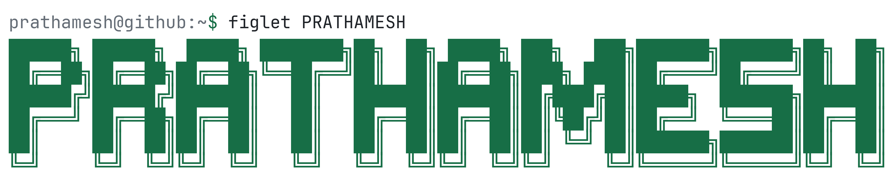
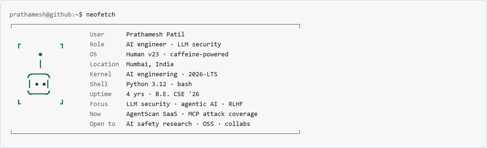

<picture>
  <source media="(prefers-color-scheme: dark)" srcset="assets/banner-dark.png">
  
</picture>

<picture>
  <source media="(prefers-color-scheme: dark)" srcset="assets/neofetch-dark.png">
  
</picture>

<h3>I build $\color{#2ea043}\textsf{agentic AI}$ systems — then try to $\color{#2ea043}\textsf{break}$ them.</h3>

```toml
# prathamesh@github:~$ cat ~/.stack
[ai]
languages = ["Python", "TypeScript", "Bash"]
llm       = ["LangChain", "OpenAI", "HuggingFace", "Pydantic"]
security  = ["OWASP LLM Top 10", "prompt injection", "jailbreak testing"]

[build]
backend   = ["FastAPI", "PostgreSQL", "Redis", "Nginx"]
frontend  = ["React", "Vite"]
devops    = ["Docker", "GitHub Actions", "pytest", "YAML"]
```

```console
prathamesh@github:~$ cat ~/.bash_history | grep -i work
# Jan 2026 → Apr 2026 · Ethara AI · LLM Post-Training Intern · Remote
# ────────────────────────────────────────────────────────────────
$ python -m evals.run --suite instruction-following,function-calling,reasoning
$ python -m rlhf.annotate --focus reasoning-quality,safety
$ python -m redteam.run --attacks prompt-injection,jailbreak,adversarial
$ vim docs/eval-rubrics.md
# Jul 2025 → Sep 2025 · MKCL · Software Developer Intern
# ────────────────────────────────────────────────────────────────
$ npm run build && npm run lint
$ uvicorn app.main:app --reload
$ docker compose up -d
$ nginx -t && systemctl reload nginx
# → production React + FastAPI behind Nginx; less manual overhead
```

```
prathamesh@github:~$ tree ~/projects
~/projects/
├── AgentScan/               # flagship · red-team AI agents
│   ├── attack-engine/       # async ABC attack modules
│   ├── mcp-guard/           # Model Context Protocol proxy
│   ├── sandbox/             # isolated container runtime
│   ├── sentinel/            # threat scoring + SARIF reports
│   └── ci-pipeline/         # GitHub Actions red-team loop
├── Sentinel-Agent/          # AI security agent
├── Authorization/           # auth + access control
├── The-Vocal-Portfolio/     # voice-directed portfolio · JavaScript
└── NewZ/                    # AI news summarizer · JavaScript
```

<picture><source media="(prefers-color-scheme: dark)" srcset="assets/agentscan-logo-dark.svg"></picture> **AgentScan** maps an agent's attack surface, fires prompt-injection exploits, and leaves you with reproducible evidence. [Site](https://github.com/PrathaMesh3056/AgentScan-Website)<br>**Sentinel Agent** · **Authorization** · [Vocal Portfolio](https://github.com/PrathaMesh3056/The-Vocal-Portfolio) · [NewZ](https://github.com/PrathaMesh3056/NewZ)

```
prathamesh@github:~$ cat ~/.education
┌─[ education ]────────────────────────────────────────────────────────────────┐
  SSBT College of Engineering
  B.E. Computer Science · Aug 2022 → Aug 2026
  GPA  8.50 / 10.0    [#################---]  85%
└──────────────────────────────────────────────────────────────────────────────┘
```

```
prathamesh@github:~$ htop
  CPU[####################--------]  71%    Tasks: 6 · 4 running
  MEM[########################----]  86%    Load:  high

  PID   PROCESS                     STATE       NOTE
  ──────────────────────────────────────────────────────────────────────────────
  001   agentscan-redteam-platform  running     SaaS + MCP attack coverage
  002   mcp-attack-surface-enum     running     tool → identity → agent paths
  003   ebpf-ai-sandboxing          running     kernel-level isolation
  004   continuous-redteam-cicd     running     red-team on every push
  005   multimodal-llm-adversarial  loading     image + audio attack paths
  006   mixture-of-experts-research queued      routing + sparse activation
  [q]uit  [k]ill  [F5]tree  [F6]sort
```

```
prathamesh@github:~$ man prathamesh
PRATHAMESH(1)                   User Commands                    PRATHAMESH(1)

NAME
       prathamesh - AI engineer, LLM security researcher, builder

SYNOPSIS
       prathamesh [--build agentic-ai] [--attack llm-systems]
                  [--stack python fastapi react] [--base mumbai]

DESCRIPTION
       AI-focused software engineer building full-stack applications,
       agentic AI systems, and LLM-integrated pipelines. Creator of
       AgentScan, a red-teaming platform for AI agents mapped to the
       OWASP LLM Top 10.

OPTIONS
       --focus       LLM security · agentic AI · post-training · RLHF
       --currently   AgentScan SaaS + MCP attack coverage
       --learning    MoE architectures · eBPF sandboxing · multimodal LLMs
       --open-to     AI safety research · OSS · select collaborations

EXIT STATUS
       0   successful collaboration
       1   coffee supply critically low

SEE ALSO
       github(1) · linkedin(1) · agentscan(1) · fastapi(1) · python(1)

PRATHAMESH(1)                   User Commands                    PRATHAMESH(1)
```

```
prathamesh@github:~$ ping -c 4 prathamesh
PING prathamesh (personal API) 56 data bytes
64 bytes from github   : icmp_seq=1  ttl=64  github.com/PrathaMesh3056
64 bytes from linkedin : icmp_seq=2  ttl=64  in/prathameshpatildev
64 bytes from email    : icmp_seq=3  ttl=64  prathameshpatil300804@gmail.com
64 bytes from agentscan: icmp_seq=4  ttl=64  AgentScan · early access
--- prathamesh ping statistics ---
4 packets transmitted, 4 received, 0% packet loss
rtt min/avg/max = instant/fast/reply
```

→ [email](mailto:prathameshpatil300804@gmail.com) · [github](https://github.com/PrathaMesh3056) · [linkedin](https://www.linkedin.com/in/prathameshpatildev) · [agentscan](https://github.com/PrathaMesh3056/AgentScan-Website)

> *“The best way to defend AI systems is to attack them first.”*
>
> `prathamesh@github:~$ _`
